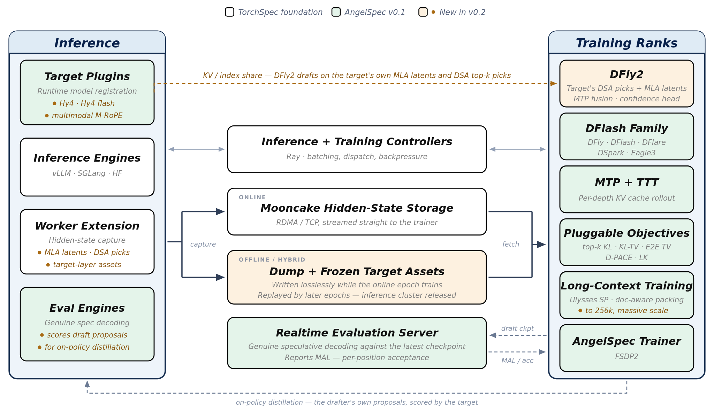
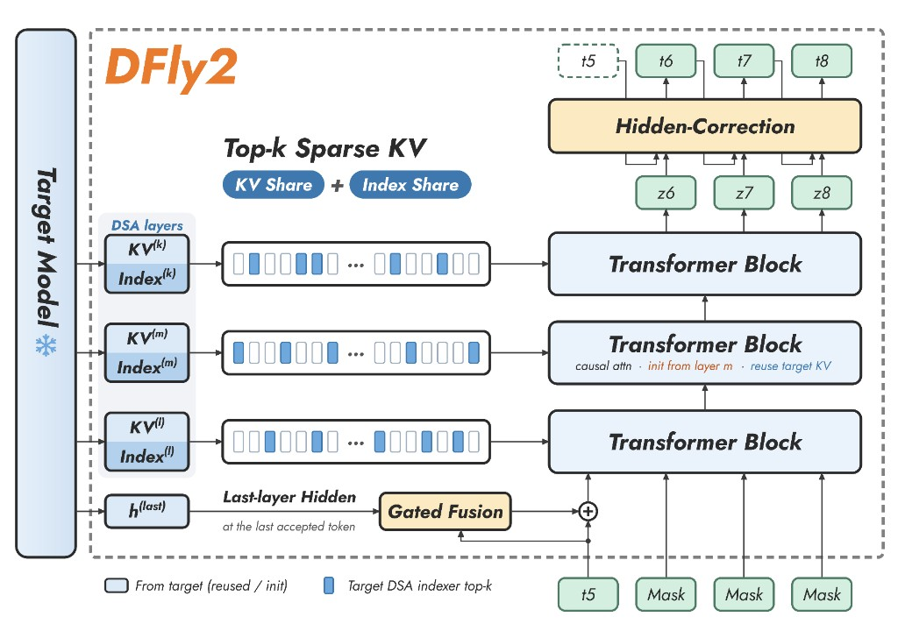
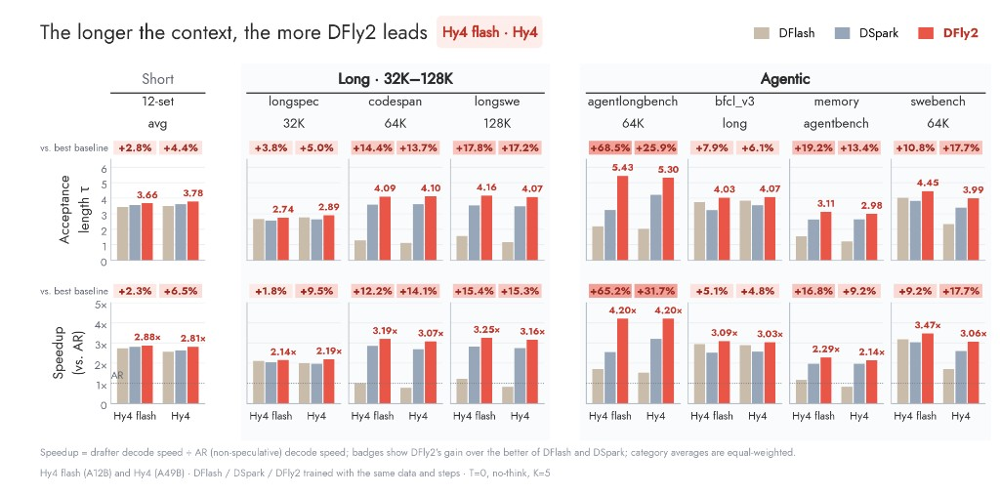

<div align="center">

<picture>
  <source media="(prefers-color-scheme: dark)" srcset="docs/_static/logo_banner_white.png">
  <source media="(prefers-color-scheme: light)" srcset="docs/_static/logo_banner.png">
  
</picture>

**A unified training framework for MTP and block-parallel speculative decoding**

[](https://arxiv.org/abs/2607.25852)
[](https://arxiv.org/abs/2611.34776)
[](https://angelspec.readthedocs.io)
[](https://huggingface.co/collections/AngelSlim/angelspec)
[](LICENSE)

</div>

AngelSpec is developed by the Tencent Hunyuan AI Infra team, which is a torch-native framework for training speculative-decoding draft models, covering both autoregressive MTP drafting and the block-parallel DFlash family. It is the training framework behind the [AngelSpec](https://arxiv.org/abs/2607.25852) and [DFly2](https://arxiv.org/abs/2611.34776) technical reports: all drafters in them — the TTT-trained MTP drafter and the DFly family, DFly2 included — are trained and released with it.

## Latest News

- **[2026/11/26]** We open-source **DFly2** in full: the [**weights**](https://huggingface.co/collections/AngelSlim/angelspec), the **training code** and the [**technical report**](https://arxiv.org/abs/2611.34776). Beyond Hy4 and Hy4 flash, DFly2 now also trains on **DeepSeek-V4.1-Flash** and **GLM-5.3-Flash**, with new MoE drafters released for [**Hy4 flash**](https://huggingface.co/AngelSlim/Hy4-flash-DFly2-B6), [**DeepSeek-V4.1-Flash**](https://huggingface.co/AngelSlim/DS-V4.1-Flash-DFly2-B6) and [**GLM-5.3-Flash**](https://huggingface.co/AngelSlim/GLM-5.3-Flash-DFly2-B6). 🔥🔥🔥
- **[2026/11/20]** We add training for **DFly2** on [**Hy4**](https://huggingface.co/tencent/Hy4). 🔥🔥🔥
- **[2026/11/18]** We release **AngelSpec v0.2.0**, adding training for **DFly2**, the speculative-decoding drafter that ships with [**Hy4 flash**](https://huggingface.co/tencent/Hy4-flash). DFly2 reuses the target's **sparse KV cache and top-k indices**, keeping drafting cost **constant at any context length**. Training for more open-source models, on-policy distillation, and the training and inference images are coming soon. 🔥🔥🔥
- **[2026/07/29]** We release AngelSpec v0.1.0, supporting MTP and block-parallel speculative decoding training. Check out our [technical report](https://arxiv.org/abs/2607.25852) and [released models](https://huggingface.co/collections/AngelSlim/angelspec).

## Key Features

- **7 draft architectures** — DFly2, DFly, DFlash, DFlare, Eagle3, DSpark, MTP — behind one training pipeline; switching is a config change
- **MTP training with TTT** — on-policy multi-depth rollout with memory close to a single causal pass; long-context training up to 256k via Ulysses sequence parallelism
- **Acceptance-aligned objectives** — CE, top-k KL, LK losses, D-PACE weighting, and end-to-end TV, composable through configuration
- **MLA / DSA drafters** — drafters that read the target's MLA latents and DSA candidates
- **Document-aware sequence packing** — Megatron-style fixed-length packing with strict cross-document isolation, on both the DFlash and MTP paths
- **Online evaluation** — genuine speculative decoding against the latest checkpoint during training, reporting mean accepted length and per-position acceptance as measured by the serving engine

## Architecture

<p align="center">
  
</p>

Inference and training run as separate GPU worker groups connected by a [Mooncake](https://github.com/kvcache-ai/Mooncake) tensor store, so hidden-state generation and optimization scale independently. This disaggregated foundation comes from [TorchSpec](https://github.com/lightseekorg/TorchSpec); AngelSpec extends it with the architectures, objectives, and training features above.

## Draft Architectures

| Architecture | Method | Key Idea |
|-------------|--------|----------|
| **DFly2** | Block-parallel | Target's own sparse-attention picks and KV latents as draft context + MTP fusion (Hy4, Hy4 flash, DeepSeek-V4.1, GLM-5.3) |
| **DFly** | Block-parallel | Hybrid target conditioning + hidden-correction AR head |
| **DFlash** | Block-parallel | Anchor sampling + parallel block generation |
| **DFlare** | Block-parallel | DFlash + learnable per-layer target fusion |
| **Eagle3** | Autoregressive TTT | Test-time training with input fusion |
| **DSpark** | Hybrid | DFlash backbone + EAGLE-style autoregressive head |
| **MTP** | Single-head TTT | Full MoE decoder layer as draft (Hy3-native) |

See the [draft-model family](https://angelspec.readthedocs.io/en/latest/concepts/draft_model_family.html) docs for details and trade-offs.

### DFly2

DFly2 is the speculative-decoding drafter [Hy4](https://huggingface.co/tencent/Hy4) and [Hy4 flash](https://huggingface.co/tencent/Hy4-flash) ship with, and AngelSpec trains it for sparse-attention targets: Hy4, Hy4 flash, [DeepSeek-V4.1-Flash](https://huggingface.co/deepseek-ai/DeepSeek-V4.1-Flash) and [GLM-5.3-Flash](https://huggingface.co/zai-org/GLM-5.3-Flash). It is built directly on the target model's Top-k Sparse KV: each draft layer shares the KV cache (KV Share) and the indexer's top-k selection (Index Share) with its corresponding sparse attention layer. This yields three advantages:

- Constant cost: each draft token attends to at most ~2K keys, regardless of context length.
- Zero extra KV memory: no separate KV cache is maintained for the drafter.
- PD-disaggregation ready: not involved in prefill; the prefill-to-decode transfer adds only one last-layer hidden state.

<p align="center">
  
</p>

Besides the dense drafter built into Hy4 flash, we also release MoE drafters on [Hugging Face](https://huggingface.co/collections/AngelSlim/angelspec).

Its lead over DFlash and DSpark grows on long-context and agentic workloads; see the [results](#long-context-and-agentic-dfly2).

## Quick Start

```bash
# Install AngelSpec + the vLLM backend
pip install -e ".[vllm]"
pip install mooncake-transfer-engine

# Single-node quickstart (8 GPUs: 4 inference + 4 training)
./examples/qwen3-8b-dfly/run.sh

# Override config values from CLI
./examples/qwen3-8b-dfly/run.sh training.learning_rate=5e-5 training.num_train_steps=500
```

Or set up a conda environment (installs mooncake too):

```bash
./tools/build_conda.sh 1 vllm     # or: sglang
micromamba activate angelspec
```

> **CUDA 12.x hosts:** PyPI's default `torch` / `vllm` wheels target CUDA 13 and won't load on a CUDA-12 driver. Install CUDA-matched wheels first — see [Installation](https://angelspec.readthedocs.io/en/latest/get_started/installation.html).

## Examples

<details open>
<summary><b>Multi-node (Hy3 target)</b></summary>

| Example | Architecture | Mode | Released Model |
|---------|-------------|------|----------------|
| [hy3-dfly](examples/hy3-dfly/) | DFly | From scratch | [AngelSlim/Hy3-DFly-Block8](https://huggingface.co/AngelSlim/Hy3-DFly-Block8) |
| [hy3-mtp](examples/hy3-mtp/) | MTP | From scratch | [AngelSlim/Hy3-MTP-TTT3](https://huggingface.co/AngelSlim/Hy3-MTP-TTT3) |

</details>

<details open>
<summary><b>Multi-node (Hy4 and Hy4 flash targets)</b></summary>

| Example | Architecture | Mode | Released Model |
|---------|-------------|------|----------------|
| [hy-v4-dfly2](examples/hy-v4-dfly2/) | DFly2 | From scratch | [tencent/Hy4](https://huggingface.co/tencent/Hy4) |
| [hy-v4-flash-dfly2](examples/hy-v4-flash-dfly2/) | DFly2 | From scratch | [tencent/Hy4-flash](https://huggingface.co/tencent/Hy4-flash) |

</details>

<details>
<summary><b>Single-node (Qwen3-8B target)</b></summary>

| Example | Architecture | Mode | Released Model |
|---------|-------------|------|----------------|
| [qwen3-8b-dspark](examples/qwen3-8b-dspark/) | DSpark | From scratch | — |
| [qwen3-8b-dfly](examples/qwen3-8b-dfly/) | DFly | From scratch | [AngelSlim/Qwen3-8B-DFly-Block8](https://huggingface.co/AngelSlim/Qwen3-8B-DFly-Block8) |
| [qwen3-8b-mtp](examples/qwen3-8b-mtp/) | MTP | From scratch | [AngelSlim/Qwen3-8B-MTP-TTT3](https://huggingface.co/AngelSlim/Qwen3-8B-MTP-TTT3) |
| [qwen3-8b-dfly-cpt](examples/qwen3-8b-dfly-cpt/) | DFly | CPT (from ckpt) | Continue from AngelSlim/Qwen3-8B-DFly-Block8 |

</details>

<details>
<summary><b>Single-node (Qwen3.5 targets)</b></summary>

| Example | Architecture | Mode | Released Model |
|---------|-------------|------|----------------|
| [qwen35-9b-dflash](examples/qwen35-9b-dflash/) | DFlash | From scratch | — |
| [qwen35-35b-a3b-mtp](examples/qwen35-35b-a3b-mtp/) | MTP | From scratch | — |

</details>

<details>
<summary><b>Available training configs</b></summary>

| Config | Architecture | Features |
|--------|-------------|----------|
| `configs/vllm_qwen3_8b_dfly.yaml` | DFly | Block-parallel + hidden correction |
| `configs/vllm_qwen3_8b_dflare.yaml` | DFlare | Per-layer target fusion |
| `configs/sglang_qwen3_8b_dflash.yaml` | DFlash | SGLang backend |
| `configs/sglang_qwen3_8b_dspark.yaml` | DSpark | Markov head + confidence |
| `configs/vllm_qwen3_8b_mtp_pack_usp_40k.yaml` | MTP | Packing + USP 40k seq |
| `configs/vllm_dsv41_flash_dfly2.yaml` | DFly2 | DeepSeek-V4.1-Flash, 32k |
| `configs/vllm_dsv41_flash_dspark.yaml` | DSpark | DeepSeek-V4.1-Flash |
| `configs/vllm_glm53_flash_dfly2.yaml` | DFly2 | GLM-5.3-Flash, 32k |

</details>

## Released Models

Draft models trained with AngelSpec:

| Model | Architecture | Target | Mode |
|-------|-------------|--------|------|
| [AngelSlim/Hy3-DFly-Block8](https://huggingface.co/AngelSlim/Hy3-DFly-Block8) | DFly | Hy3 | No-think |
| [AngelSlim/Hy3-DFly-Block8-Think-High](https://huggingface.co/AngelSlim/Hy3-DFly-Block8-Think-High) | DFly | Hy3 | High-think |
| [AngelSlim/Hy3-MTP-TTT3](https://huggingface.co/AngelSlim/Hy3-MTP-TTT3) | MTP | Hy3 | No-think |
| [AngelSlim/Qwen3-8B-DFly-Block8](https://huggingface.co/AngelSlim/Qwen3-8B-DFly-Block8) | DFly | Qwen3-8B | No-think |
| [AngelSlim/Qwen3-8B-MTP-TTT3](https://huggingface.co/AngelSlim/Qwen3-8B-MTP-TTT3) | MTP | Qwen3-8B | No-think |

## Benchmark

### Long-context and agentic (DFly2)

<p align="center">
  
</p>

Mean accepted length τ on DeepSeek-V4.1-Flash, GLM-5.3-Flash and Hy4 flash, each cell at temperature 0 / 1 (0.9 on Hy4 flash):

| Target | Drafter | LongSpec 32K | CodeSpan 64K | LSWE 128K | ALB | MemAgent | BFCL-v3 | SWE 64K | Long | Agentic |
|---|---|:-:|:-:|:-:|:-:|:-:|:-:|:-:|:-:|:-:|
| DeepSeek-V4.1-Flash | DFlash | 2.98 / 2.55 | 3.81 / 3.13 | 3.42 / 2.96 | 4.38 / 4.13 | 2.84 / 2.60 | 3.40 / 3.11 | 3.58 / 3.14 | 3.40 / 2.88 | 3.55 / 3.25 |
|  | DFlash† | 2.74 / 2.40 | 3.43 / 2.86 | 3.15 / 2.77 | 3.78 / 3.62 | 2.80 / 2.52 | 3.21 / 2.98 | 3.19 / 2.80 | 3.11 / 2.68 | 3.24 / 2.98 |
|  | DSpark | 2.82 / 2.48 | 3.58 / 2.92 | 3.29 / 2.98 | 3.87 / 3.59 | 2.85 / 2.65 | 3.33 / 3.09 | 3.35 / 2.99 | 3.23 / 2.79 | 3.35 / 3.08 |
|  | **DFly2** | **3.12** / **2.81** | **4.14** / **3.59** | **3.97** / **3.55** | **5.10** / **4.72** | **3.36** / **3.13** | **3.77** / **3.55** | **4.02** / **3.60** | **3.74** / **3.32** | **4.06** / **3.75** |
| GLM-5.3-Flash | DFlash | 2.55 / 2.17 | 3.12 / 2.48 | 2.92 / 2.64 | 3.12 / 1.92 | 2.79 / 2.50 | 2.99 / 2.75 | 2.91 / 2.60 | 2.86 / 2.43 | 2.95 / 2.44 |
|  | DFlash† | 2.69 / 2.23 | 3.22 / 2.60 | 2.97 / 2.65 | 3.50 / 3.45 | 2.68 / 2.48 | 3.00 / 2.73 | 2.86 / 2.61 | 2.96 / 2.50 | 3.01 / 2.82 |
|  | DSpark | 2.75 / 2.37 | 3.32 / 2.77 | 3.08 / 2.79 | 3.53 / 3.73 | 2.74 / 2.58 | 3.15 / 2.91 | 2.98 / 2.74 | 3.05 / 2.64 | 3.10 / 2.99 |
|  | **DFly2** | **3.31** / **2.92** | **4.40** / **3.63** | **3.82** / **3.52** | **5.49** / **4.77** | **3.30** / **3.12** | **3.61** / **3.35** | **3.73** / **3.48** | **3.85** / **3.36** | **4.03** / **3.68** |
| Hy4 flash | DFlash | 2.59 / 2.41 | 1.17 / 1.10 | 1.12 / 1.09 | 1.50 / 1.36 | 1.08 / 1.06 | 3.18 / 3.20 | 2.26 / 1.88 | 1.63 / 1.53 | 2.00 / 1.88 |
|  | DFlash† | 2.68 / 2.50 | 3.47 / 3.28 | 3.23 / 3.06 | 3.32 / 3.06 | 2.63 / 2.47 | 2.90 / 2.92 | 3.40 / 2.94 | 3.13 / 2.95 | 3.06 / 2.85 |
|  | DSpark | 2.74 / 2.56 | 3.54 / 3.35 | 3.31 / 3.11 | 3.32 / 3.10 | 2.77 / 2.56 | 3.08 / 2.98 | 3.45 / 3.14 | 3.20 / 3.01 | 3.16 / 2.95 |
|  | **DFly2** | **2.94** / **2.75** | **4.12** / **4.03** | **3.83** / **3.60** | **5.41** / **5.22** | **3.23** / **2.95** | **3.69** / **3.67** | **4.12** / **3.70** | **3.63** / **3.46** | **4.11** / **3.88** |

Speedup over autoregressive decoding, greedy at a concurrency of one, as decoding / end-to-end:

| Target | Drafter | LongSpec 32K | CodeSpan 64K | LSWE 128K | ALB | MemAgent | BFCL-v3 | SWE 64K | Long | Agentic |
|---|---|:-:|:-:|:-:|:-:|:-:|:-:|:-:|:-:|:-:|
| DeepSeek-V4.1-Flash | DFlash | **2.46×** / 1.75× | 3.05× / 1.67× | 2.59× / 1.16× | 3.46× / 0.69× | 2.22× / 0.63× | 2.67× / 0.78× | 2.79× / 1.49× | 2.70× / 1.52× | 2.78× / 0.90× |
|  | DFlash† | 2.32× / 1.70× | 2.70× / 1.55× | 2.52× / 1.13× | 3.09× / 0.83× | 2.25× / 0.69× | 2.63× / 0.84× | 2.55× / 1.47× | 2.51× / 1.46× | 2.63× / 0.96× |
|  | DSpark | 2.28× / 1.99× | 2.63× / 2.06× | 2.49× / 1.68× | 2.95× / 1.21× | 2.37× / **1.27×** | 2.58× / **1.37×** | 2.54× / 1.89× | 2.47× / 1.91× | 2.61× / 1.44× |
|  | **DFly2** | 2.44× / **2.10×** | **3.23×** / **2.37×** | **2.94×** / **1.86×** | **3.82×** / **1.25×** | **2.60×** / 1.24× | **2.97×** / 1.36× | **3.00×** / **2.13×** | **2.87×** / **2.11×** | **3.10×** / **1.50×** |
| GLM-5.3-Flash | DFlash | 1.70× / 1.47× | 2.03× / 1.46× | 1.89× / 1.28× | 2.15× / 1.09× | 1.83× / **1.01×** | 2.02× / 1.16× | 1.88× / 1.36× | 1.87× / 1.40× | 1.97× / 1.15× |
|  | DFlash† | 1.86× / 1.56× | 2.12× / 1.48× | 2.04× / 1.28× | 2.45× / 1.07× | 1.92× / 0.97× | 2.08× / 1.09× | 1.99× / 1.50× | 2.00× / 1.44× | 2.11× / 1.16× |
|  | DSpark | 1.84× / 1.53× | 2.24× / 1.58× | 2.12× / 1.38× | 2.48× / 1.08× | 1.90× / 0.97× | 2.17× / 1.13× | 2.02× / 1.49× | 2.07× / 1.49× | 2.14× / 1.17× |
|  | **DFly2** | **2.14×** / **1.75×** | **2.82×** / **1.79×** | **2.40×** / **1.39×** | **3.57×** / **1.10×** | **2.20×** / 0.98× | **2.34×** / **1.17×** | **2.35×** / **1.62×** | **2.45×** / **1.64×** | **2.61×** / **1.22×** |
| Hy4 flash | DFlash | 2.15× / 1.93× | 0.96× / 0.96× | 0.90× / 1.00× | 1.23× / 1.06× | 0.87× / 0.97× | 2.64× / 1.87× | 1.87× / 1.46× | 1.34× / 1.30× | 1.65× / 1.34× |
|  | DFlash† | 2.28× / 2.03× | 2.96× / 2.26× | 2.75× / 1.60× | 2.81× / 1.26× | 2.18× / 1.29× | 2.46× / 1.82× | 2.90× / 1.80× | 2.66× / 1.96× | 2.59× / 1.54× |
|  | DSpark | 2.32× / 2.06× | 3.00× / 2.28× | 2.79× / 1.60× | 2.80× / 1.26× | 2.23× / 1.27× | 2.59× / 1.85× | 2.92× / 1.81× | 2.70× / 1.98× | 2.63× / 1.55× |
|  | **DFly2** | **2.47×** / **2.17×** | **3.48×** / **2.51×** | **3.22×** / **1.68×** | **4.55×** / **1.35×** | **2.54×** / **1.31×** | **3.08×** / **2.04×** | **3.46×** / **1.96×** | **3.06×** / **2.12×** | **3.41×** / **1.67×** |

Long and Agentic average the three long-context and four agentic sets; the best result per target is in bold. DFlash† reads only a window of the context at decode but still builds a full cache at prefill.

## License

This project is released under [LICENSE](LICENSE). AngelSpec is built upon [TorchSpec](https://github.com/lightseekorg/TorchSpec) by LightSeek Foundation and uses [Mooncake](https://github.com/kvcache-ai/Mooncake) for disaggregated hidden-state transfer.

## Citation

If you find AngelSpec or DFly2 useful, please cite:

```bibtex
@article{angelspec2026,
  title   = {AngelSpec: Towards Real-World High Performance Inference with Speculative Decoding},
  author  = {Liu, Hong and Cen, Rui and Shi, Junhan and Qin, Guangshuo and Zhang, Jiebin and Liu, Tianyu and Fan, Runzhi and Zhao, Guoliang and Xie, Ruobing and Zhang, Kai and Liu, Song and Yu, Guanghua and Zhu, Jianchen},
  journal = {arXiv preprint arXiv:2607.25852},
  year    = {2026}
}

@article{dfly2_2026,
  title   = {DFly2: Turbocharging Long-Context Speculative Decoding by Sharing the Target's Sparsity},
  author  = {Liu, Hong and Cen, Rui and Shi, Junhan and Niu, Lin and Fan, Runzhi and Zhou, Zhaojing and Lei, Haodi and Zhang, Jiebin and Yang, Saiyong and Zheng, Junqiang and Xue, Zhenghai and Yu, Guanghua and Zhu, Jianchen},
  journal = {arXiv preprint arXiv:2611.34776},
  year    = {2026}
}
```

## Projects in teams

- [AngelSlim](https://github.com/Tencent/AngelSlim): A more accessible, comprehensive, and efficient toolkit for large model compression.
